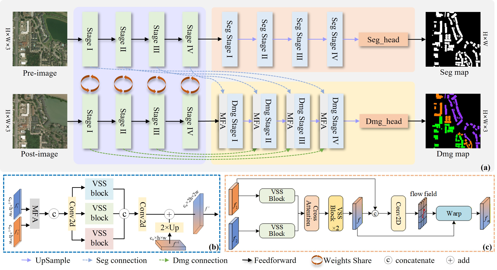
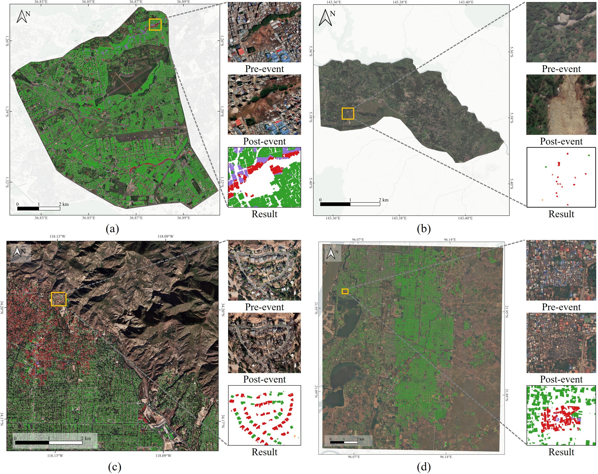

<div align="center">
<h1 align="center">FlowMamba</h1>

<h3>FlowMamba: Building Damage Assessment via Optics Flow-based State Space Model</h3>

[Xin Guo](https://orcid.org/0000-0003-1448-8978)<sup>1</sup>, [Xudong Kang](https://orcid.org/0000-0002-3807-2531)<sup>1 *</sup>, [Zihao Wang](https://chengxihan.github.io/)<sup>1</sup>, [Qiong Wu](https://scholar.google.com/citations?user=n1aKdTkAAAAJ&hl=en)<sup>1</sup>, [Puhong Duan](https://orcid.org/0000-0001-5066-4399)<sup>1</sup>, [Bin Yang](https://orcid.org/0000-0001-6127-3385)<sup>1</sup>, [Shutao Li](https://orcid.org/0000-0002-0585-9848)<sup>1</sup>

<sup>1</sup> Hunan University, Changsha, China
<sup>*</sup> Corresponding author

[**Overview**](#overview) | [**Get Started**](#%EF%B8%8Flets-get-started) | [**Main Results**](#%EF%B8%8Fmain-results) | [**Application**](#application) | [**Reference**](#reference) | [**Q & A**](#q--a)

</div>

## 🛎️Updates
* **`💡Notice`**: The code of this repo has been updated! Some of the retrained model weights have been uploaded for usage! We'd appreciate it if you could give this repo ⭐️ and stay tuned! The models and training code for FlowMamba and comparative methods have been organized and uploaded. You are welcome to use them!!
* **`🎯Dec 12th, 2025`**: The paper has been accepted by TCSVT! The final version of the paper has been uploaded!

## 🔭Overview

* [**FlowMamba**](https://ieeexplore.ieee.org/document/11299103) serves as a competitive solution for robust building damage assessment under complex disaster scenarios.
<p align="center">
  
</p>

## 🗝️Let's Get Started!
### A. Installation
The repo is based on the [VMamba repo](https://github.com/MzeroMiko/VMamba), thus you need to install it first. The following installation sequence is taken from the VMamba repo. Also, note that the code in this repo runs under Linux system. We have not tested whether it works under other OS.

**Step 1: Clone the repository:**

Clone this repository and navigate to the project directory:
```bash
git clone https://github.com/flying318/FlowMamba.git
cd FlowMamba
```

**Step 2: Environment Setup:**

It is recommended to set up a conda environment and installing dependencies via pip. Use the following commands to set up your environment:

***Create and activate a new conda environment***

```bash
conda create -n flowmamba python=3.11
conda activate flowmamba
```

***Install dependencies***

```bash
pip install -r requirements.txt
cd kernels/selective_scan && pip install .
```


***Dependencies for `Detection` and `Segmentation` (optional in VMamba)***

```bash
pip install mmengine==0.10.1 mmcv==2.1.0 opencv-python-headless ftfy regex
pip install mmdet==3.3.0 mmsegmentation==1.2.2 mmpretrain==1.2.0
```
### B. Download Pretrained Weight
Also, please download the pretrained weights of [VMamba-Tiny](https://github.com/MzeroMiko/VMamba/releases/download/%2320240316/vssm_tiny_0230_ckpt_epoch_262.pth), [VMamba-Small](https://github.com/MzeroMiko/VMamba/releases/download/%2320240316/vssm_small_0229_ckpt_epoch_222.pth), and [VMamba-Base](https://github.com/MzeroMiko/VMamba/releases/download/%2320240316/vssm_base_0229_ckpt_epoch_237.pth) and put them under 
```bash
project_path/FlowMamba/pretrained_weight/
```

### C. Data Preparation
***Building damage assessment***

The xBD dataset can be downloaded from [xView 2 Challenge website](https://xview2.org/dataset). After downloading it, please organize it into the following structure: 
```
${DATASET_ROOT}   # Dataset root directory, for example: /home/username/data/xBD
├── train
│   ├── images
│   │   ├──guatemala-volcano_00000000_pre_disaster.png
│   │   ├──guatemala-volcano_00000000_post_disaster.png
│   │   ...
│   │
│   └── masks
│       ├──guatemala-volcano_00000003_pre_disaster.png
│       ├──guatemala-volcano_00000003_post_disaster.png
│       ... 
│   
├── test
│   ├── ...
│   ...
│
├── holdout
│   ├── ...
│   ...
│
├── train.txt # Data name list, recording all the names of training data
├── test.txt  # Data name list, recording all the names of testing data
└── holdout.txt  # Data name list, recording all the names of holdout data
```

### D. Model Training
Before training models, please enter into [**changedetection**] folder, which contains all the code for network definitions, training and testing. 
```bash
cd <project_path>
bash run/train.sh
```
### E. Model Evaluation
To evaluate the trained model, please run the following command:
```bash
cd <project_path>
bash run/test.sh
```

## ⚗️Main Results
* *The encoders for all the above FlowMamba models are the the VMamba architecture initialized with ImageNet pre-trained weight.*

|     Methods     |  Backbones   | No Dmg. | Minor Dmg. | Major Dmg. | Destroyed | F<sub>1</sub><sup>loc</sup> | F<sub>1</sub><sup>dmg</sup> | F<sub>1</sub><sup>overall</sup> | Params | GFLOPs  |
| :-------------: | :----------: | :-----: | :--------: | :--------: | :-------: | :-------------------------: | :-------------------------: | :-----------------------------: | :----: | :-----: |
|    ChangeOS     |  ResNet-50   |  94.46  |   54.64    |   72.27    |   85.88   |            84.68            |            73.57            |              76.91              | 50.60  | 117.53  |
|      CGNet      |  ResNet-50   |  91.85  |   45.41    |   60.97    |   81.58   |            82.52            |            64.97            |              70.23              | 94.08  | 274.56  |
|     HCGMNet     |  ResNet-50   |  86.84  |   34.86    |   59.77    |   72.43   |            84.02            |            56.54            |              64.79              | 99.91  | 747.08  |
|    USSFCNet     |     None     |  93.90  |   48.90    |   72.11    |   81.19   |            77.43            |            69.83            |              72.11              |  4.89  | 125.07  |
|     DMINet      |  ResNet-50   |  94.00  |   54.35    |   73.80    |   86.90   |            85.30            |            73.95            |              77.35              | 78.28  | 1005.00 |
|     RFANet      |  ResNet-50   |  90.22  |   47.42    |   70.40    |   87.00   |            85.42            |            69.12            |              74.01              | 25.89  | 122.66  |
|       BiT       |  ResNet-50   |  93.60  |   55.61    |   67.16    |   86.60   |            86.10            |            72.59            |              76.64              |  9.00  | 188.11  |
|  ChangeFormer   | ChangeFormer |  92.87  |   49.10    |   70.93    |   83.28   |            79.58            |            69.88            |              72.79              | 45.99  | 3090.59 |
|     SAM-CD      |  FastSAM-x   |  93.28  |   47.74    |   66.06    |   83.86   |            73.08            |            68.11            |              69.60              |  2.59  |  68.77  |
|     RSMamba     |     None     |  93.59  |   50.42    |   71.34    |   79.50   |            70.95            |            70.03            |              70.31              | 42.30  | 152.58  |
|   ChangeMamba   |  VSSM-Small  |  94.99  |   60.35    |   76.14    |   87.00   |            86.71            |            77.33            |              80.14              | 52.11  | 261.61  |
| FlowMamba(Ours) |  VSSM-Small  |  94.97  |   60.71    |   76.21    |   87.82   |            87.24            |            77.65            |              80.53              | 56.83  | 386.37  |

## 🌏Application
Four disaster scenarios are tested, including (a) Nairobi Flood 2024 ([News](https://en.wikipedia.org/wiki/2024_Kenya-Tanzania_floods), [online_map](https://flying318.github.io/web_share/qgis2web/nairobi_flood/index.html)), (b) PNG landslide 2024 ([News](https://en.wikipedia.org/wiki/2024_Enga_landslide), [online_map](https://flying318.github.io/web_share/qgis2web/png_landslide/index.html)), (c) Los Angeles 2025
wildfire ([News](https://en.wikipedia.org/wiki/January_2025_Southern_California_wildfires), [online_map](https://flying318.github.io/web_share/qgis2web/losangeles_wildfire/index.html)), and (d) Myanmar earthquake 2025 ([News](https://en.wikipedia.org/wiki/2025_Myanmar_earthquake), [online_map](https://flying318.github.io/web_share/qgis2web/myanmar_earthquake/index.html)).
<p align="center">
  
</p>

## 📜Reference

If this code or dataset contributes to your research, please kindly consider citing our paper and give this repo ⭐️ :)
```
@ARTICLE{11299103,
  author={Guo, Xin and Kang, Xudong and Wang, Zihao and Wu, Qiong and Duan, Puhong and Yang, Bin and Li, Shutao},
  journal={IEEE Transactions on Circuits and Systems for Video Technology}, 
  title={FlowMamba: Building Damage Assessment via Optics Flow-based State Space Model}, 
  year={2025},
  volume={},
  number={},
  pages={1-1},
  keywords={Decoding;Feature extraction;Buildings;Disasters;Remote sensing;Accuracy;Optical flow;Architecture;Transformers;Convolution;Remote sensing images;Building damage assessment;Flow alignment;Vision mamba},
  doi={10.1109/TCSVT.2025.3643612}}
```

## 🤝Acknowledgments
This project is based on ChangeMamba ([paper](https://ieeexplore.ieee.org/document/10565926),[code](https://github.com/ChenHongruixuan/ChangeMamba.git)), VMamba ([paper](https://arxiv.org/abs/2401.10166), [code](https://github.com/MzeroMiko/VMamba)), ScanNet ([paper](https://arxiv.org/abs/2212.05245), [code](https://github.com/ggsDing/SCanNet)), xView2 Challenge ([paper](https://openaccess.thecvf.com/content_CVPRW_2019/papers/cv4gc/Gupta_Creating_xBD_A_Dataset_for_Assessing_Building_Damage_from_Satellite_CVPRW_2019_paper.pdf), [code](https://github.com/DIUx-xView/xView2_baseline)). Thanks for their excellent works!!

## 🙋Q & A
***For any questions, please feel free to [contact us.](mailto:flyinggx@hnu.edu.cn)***